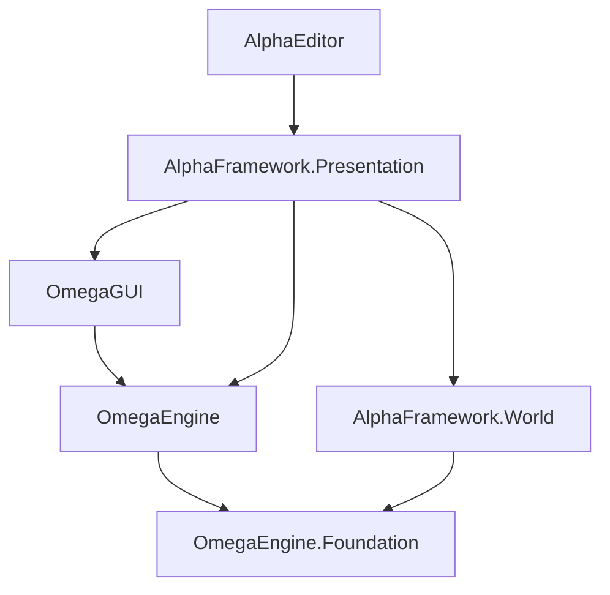

<xref:OmegaEngine> is a 3D graphics engine for .NET that you install as a NuGet package and drive entirely from C#. A few lines of code give you a 3D view, in its own window or embedded in your WinForms application.

## Why OmegaEngine?

- **A library, not an IDE.** Reference a package, write code, press F5. Your project stays a normal C# project.
- **Embeds in your application.** [RenderPanel](hosting.md#renderpanel) is a regular WinForms control, so a 3D view sits next to your other controls in editors, viewers and visualization tools.
- **From millimeters to planets.** Positions are stored with [64-bit precision](xref:OmegaEngine.Graphics.Cameras#floating-coordinate-system) and [distance compression](scenes.md#distance-compression) keeps far-away objects in view, so one scene can hold both a spaceship and the planet it orbits.
- **Take only what you need.** Use the engine on its own, or add a GUI toolkit, a game framework and an editor toolkit. See [Building blocks](#building-blocks).
- **Moddable by default.** An [overlay filesystem](xref:OmegaEngine.Foundation.Storage) lets mods add or replace any content file without touching the original.
- **Small and undemanding.** About 8 MB including all dependencies, and it runs on every GPU with a Windows 10/11 driver.

See [Features](features.md) for the full list and screenshots.

## First steps

The quickest start is one of the [project templates](https://www.nuget.org/packages/OmegaEngine.Templates#readme-body-tab):

```shell
dotnet new install OmegaEngine.Templates
dotnet new omegaengine-winforms -o MyApp
```

| Template                       | Creates                                                              |
| ------------------------------ | -------------------------------------------------------------------- |
| `omegaengine-winforms`         | A WinForms application with an embedded 3D view.                     |
| `omegaengine-fullscreen`       | A fullscreen application.                                            |
| `omegaengine-alphaframework`   | A game based on <xref:AlphaFramework>, together with its own editor. |

To add the engine to a project of your own instead, create a WinForms project targeting .NET Framework 4.7.2 or newer with the platform set to `x86`.  
Add a reference to the NuGet package `OmegaEngine`. Then add the following code to render a textured sphere:

```csharp
var engine = new Engine(this, new EngineConfig { TargetSize = ClientSize });
var scene = new Scene
{
    Positionables = { Model.Sphere(engine, XTexture.Get(engine, "flag.png")) }
};
var view = new View(scene, new ArcballCamera()) { BackgroundColor = Color.CornflowerBlue };
engine.Views.Add(view);

Paint += delegate { engine.Render(); };
```

> [!TIP]
> See [Hosting](hosting.md) for more advanced render loops.

### Requirements

> [!WARNING]
> You additionally need to ensure these native dependencies are installed or bundled with your application:
> - [Visual C++ 2010 Redistributable x86](https://www.microsoft.com/en-us/download/details.aspx?id=26999)
> - [DirectX June 2010 Runtime](https://www.microsoft.com/en-us/download/details.aspx?id=8109)

> [!NOTE]
> The engine requires a graphics card with Shader Model 3.0 support. Every GPU with a Windows 10/11 driver meets this.

## Building blocks

Start with the engine and add the other parts as your project grows:

<xref:OmegaEngine> renders your scenes and handles input and audio.  
It is all you need for a viewer or a visualization.

<xref:OmegaGUI> is a GUI toolkit for OmegaEngine with an XML file format and Lua scripting.  
Use it for menus, HUDs and dialogs.

<xref:AlphaFramework> is a complementary framework for OmegaEngine.  
It provides base classes for designing a game world using the Model-View-Presenter pattern. The world model does not depend on the engine and also runs on modern .NET, so game logic can be unit-tested or run without a graphics card.

[AlphaEditor](xref:AlphaFramework.Editor) is a toolkit for building an editor for your own game.  
It comes with WYSIWYG editors for GUI dialogs and particle systems.

<xref:FrameOfReference> is the official sample game for OmegaEngine.  
It uses all of the above and is intended as a reference for developers working on other games.

### NuGet packages

| Package                                                                                    | Namespace                          | Description                                                         |
| ------------------------------------------------------------------------------------------ | ---------------------------------- | ------------------------------------------------------------------- |
| [OmegaEngine](https://www.nuget.org/packages/OmegaEngine/)                                 | <xref:OmegaEngine>                 | 3D graphics rendering based on DirectX 9.                           |
| [OmegaEngine.Foundation](https://www.nuget.org/packages/OmegaEngine.Foundation/)           | <xref:OmegaEngine.Foundation>      | Rendering-agnostic infrastructure like storage and data structures. |
| [OmegaGUI](https://www.nuget.org/packages/OmegaGUI/)                                       | <xref:OmegaGUI>                    | GUI toolkit with XML file format and Lua scripting.                 |
| [AlphaFramework.World](https://www.nuget.org/packages/AlphaFramework.World/)               | <xref:AlphaFramework.World>        | Basis for engine-agnostic models of game worlds.                    |
| [AlphaFramework.Presentation](https://www.nuget.org/packages/AlphaFramework.Presentation/) | <xref:AlphaFramework.Presentation> | Basis for presenters that visualize game worlds using the engine.   |
| [AlphaEditor](https://www.nuget.org/packages/AlphaEditor/)                                 | <xref:AlphaFramework.Editor>       | Toolkit for creating editors for games based on AlphaFramework.     |



## Next steps

- [Features](features.md): everything the engine can do, with screenshots.
- [Scenes](scenes.md): how scenes, views and cameras fit together.
- [Hosting](hosting.md): render loops for embedded and standalone applications.
- <xref:FrameOfReference>: a complete game to learn from.
